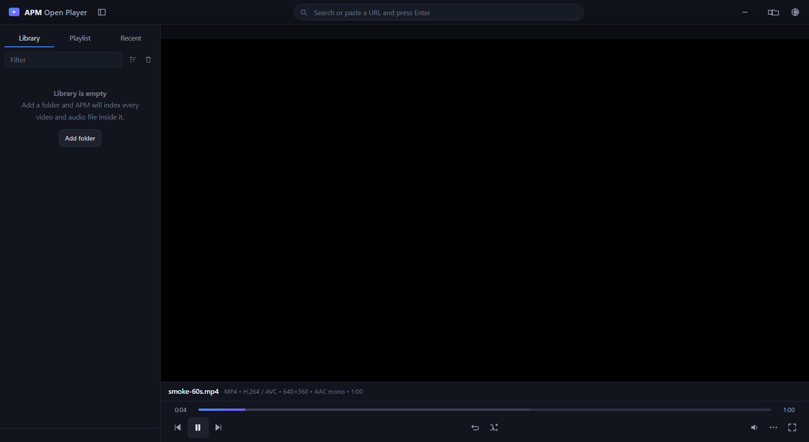

# APM Open Player



**One player. Every format. Every platform.**

APM Open Player is a universal media player that combines the best of what VLC,
MX Player and KM Player do into one open-source application — and plays **every**
video and audio format, on **Android, Windows and macOS**.

It is not a wrapper around any one of those apps. It is a fresh player built on
**libmpv** (mpv's player core) and **libVLC/FFmpeg**, which are the two most
complete open media stacks in existence. That is what makes "supports everything"
a real engineering claim rather than a marketing line: the decoder inventory
below is measured from the shipped binary, not copied from a feature list.

---

## What it plays

### Video containers
`MP4` `M4V` `MKV` `WEBM` `AVI` `MOV` `QT` `WMV` `ASF` `FLV` `F4V` `TS` `M2TS`
`MTS` `M2V` `VOB` `OGV` `3GP` `3G2` `MPG` `MPEG` `M1V` `RM` `RMVB` `DIVX` `MXF`
`DV` `NSV` `M2P` `DVDR` `SWF` `AMV` `Y4M`

### Video codecs
H.264/AVC · HEVC/H.265 · AV1 · VP8 · VP9 · MPEG-1/2/4 Part 2 · VC-1 · WMV1/2/3 ·
H.263 / Sorenson H.263 · Apple ProRes · Avid DNxHD · DV · Theora · FFV1 ·
UTVideo · CineForm · v210 · QuickTime RLE · Motion JPEG · RealVideo

### Audio formats
`MP3` `AAC` `M4A` `M4B` `FLAC` `WAV` `AIFF` `OGG` `OGA` `OPUS` `VORBIS` `WMA`
`WMA Lossless` `APE` `WavPack` `TTA` `ALAC` `DTS` `AC3` `E-AC3` `TRUEHD` `MLP`
`AMR` `GSM` `Speex` `MIDI` `MOD` `S3M` `XM` `IT`

> **E-AC-3, TrueHD, DTS, APE and WavPack are the ones phones usually refuse.**
> They play here because the decode engine is FFmpeg, not the OS media stack.

### Subtitles
`SRT` `ASS` `SSA` `VTT` `SMI` `SAMI` `SUB`/`IDX` (VobSub) · PGS (Blu-ray) ·
DVB · MOV text · MicroDVD · SubViewer

### Network
`http://` `https://` `rtsp://` `rtmp://` `rtmps://` `udp://` `tcp://` `srt://`
`mms://` `ftp://` · HLS (`.m3u8`) · DASH (`.mpd`)

### Size and length
There is no file-size limit in the player itself. Resolution is limited only by
your hardware decode support — 4K/2160p HEVC and AV1 are verified in the test
suite, and hardware decoding is enabled by default.

---

## Features

**The interface**
Five controls on Android, seven on desktop: previous, play, next, and the two
or three that earn their place. Everything else — tracks, subtitles, speed,
snapshot, conversion, effects, settings — is one tap away in the **⋯** menu,
and the keyboard does it faster on PC. A media player you cannot work out at a
glance is a media player people uninstall.

**Playback**
- Playlist with shuffle, loop-one, loop-all, drag-to-reorder
- Resume playback where you stopped off (per file, persisted)
- Frame-by-frame stepping, 10 s / 60 s jumps, chapter navigation
- Playback speed 0.25×–4×
- Picture-in-picture / floating mini-player
- Background playback with media notification (Android + desktop)

**Audio**
- Track selection for multi-audio files
- 10-band equaliser with presets
- Headphone / surround / mono stereo modes
- Pitch shift and tempo change
- Audio delay adjustment, sync mode

**Video**
- Hardware decoding (D3D11VA, NVENC/NVDEC, Quick Sync, VA-API, VideoToolbox, MediaCodec)
- Brightness / contrast / saturation / hue / gamma
- Deinterlace, aspect ratio and crop
- Live snapshots (with or without subtitles)

**Subtitles**
- External subtitle files, plus automatic loading of matching files beside the media
- Font, size, colour, outline, bold, shadow
- Subtitle delay

**Library**
- Watch-folder indexing with thumbnails
- Recents with resume positions
- Full-text filter and sorting

**Conversion**
- Remux without re-encoding (MKV ↔ MP4)
- H.264, HEVC, VP9/AV1, MP3, FLAC, AAC output presets
- Resize to 720p / 1080p
- Burn in subtitles
- Repair broken timestamps

**Interface**
- Full keyboard control (VLC-style shortcuts)
- Dark theme, frameless window, DPI aware
- Works on Windows, macOS and Android from one codebase for desktop

---

## 📥 Download

**AM Player (AMP) — Open Architecture Power Media Player**  
Short name: **AMP Open Player**. One codebase, three platforms, every format.

Seven separate builds. Take the one that matches your machine and nothing else.

### Windows 64-bit

| Build | File | Notes |
| --- | --- | --- |
| **Installer** (recommended) | `APM-Open-Player-1.0.0-Windows-x64-Setup.exe` | 174 MB, NSIS, per-user, no admin |
| **Portable** | `APM-Open-Player-1.0.0-Windows-x64-Portable.exe` | no install at all, one folder |

<a href="https://github.com/Abhijeet-Kumar-Prajapati/Open-Architecture-Power-Media-Player.--Software-Andriod-Mac-Os/releases/download/v1.0.0/APM-Open-Player-1.0.0-Windows-x64-Setup.exe"></a>
<a href="https://github.com/Abhijeet-Kumar-Prajapati/Open-Architecture-Power-Media-Player.--Software-Andriod-Mac-Os/releases/download/v1.0.0/APM-Open-Player-1.0.0-Windows-x64-Portable.exe"></a>

### macOS

| Build | File | Notes |
| --- | --- | --- |
| **Apple Silicon** | `APM-Open-Player-1.0.0-macos-arm64.zip` | 125 MB, M1 / M2 / M3 / M4 |
| **Intel** | `APM-Open-Player-1.0.0-macos-x64.zip` | 129 MB, older Macs |

<a href="https://github.com/Abhijeet-Kumar-Prajapati/Open-Architecture-Power-Media-Player.--Software-Andriod-Mac-Os/releases/download/v1.0.0/APM-Open-Player-1.0.0-macos-arm64.zip"></a>
<a href="https://github.com/Abhijeet-Kumar-Prajapati/Open-Architecture-Power-Media-Player.--Software-Andriod-Mac-Os/releases/download/v1.0.0/APM-Open-Player-1.0.0-macos-x64.zip"></a>

> **Which Mac do I have?**  &#63743; menu → **About This Mac**. "Apple M1/M2/M3/M4" means arm64,
> anything older means Intel.  
> Both need `brew install mpv` before the first run.

### Android

| Build | File | Notes |
| --- | --- | --- |
| **APK** | `APM-Open-Player-1.0.0.apk` | 96 MB, ARM phones, Android 5.0+ |

<a href="https://github.com/Abhijeet-Kumar-Prajapati/Open-Architecture-Power-Media-Player.--Software-Andriod-Mac-Os/releases/download/v1.0.0/APM-Open-Player-1.0.0.apk"></a>

Copy the APK to the phone, tap it and allow "Install anything". ARM only — it will not run on an x86 emulator.

### Also available

- **All releases** — <https://github.com/Abhijeet-Kumar-Prajapati/Open-Architecture-Power-Media-Player.--Software-Andriod-Mac-Os/releases>
- **Source archive** — `APM-Open-Player-1.0.0-source.zip`, or clone and follow [docs/BUILDING.md](docs/BUILDING.md)
- **Download page** — <https://abhijeet-kumar-prajapati.github.io/Open-Architecture-Power-Media-Player.--Software-Andriod-Mac-Os/#download>

> These links point at the `v1.0.0` tag, so they always resolve to this exact build.  
> Nothing is unsigned, so Windows SmartScreen and macOS Gatekeeper both warn on first run —
> click **More info → Run anyway** (Windows) or right-click → **Open** (macOS).

### Why the files are so large

Codecs. FFmpeg plus the Chromium runtime that hosts the interface. That is the cost of
"plays every format", and it is not a bug. The reasoning, with the measured breakdown of
what could and could not be cut, is in [docs/VERIFICATION.md §5](docs/VERIFICATION.md).

## How it is built

```
APM-Open-Player/
├── desktop/          Electron app — Windows + macOS
│   ├── src/main/     main process, libmpv engine, Win32 video host
│   ├── src/renderer/ UI
│   └── vendor/mpv/   libmpv shared library
├── android/          Android app — libVLC (FFmpeg) for Android
├── tools/            test media generator + verification harnesses
└── docs/             build instructions and format reference
```

### The interesting engineering problem

Embedding a video surface inside an Electron window is not a solved problem:
Chromium will not render native video on top of itself.

APM solves it on Windows by creating a **native Win32 child window** and having
mpv parent its own rendering surface inside it. The renderer measures the media
area and reports its rectangle over IPC; the main process moves the native
window to match, DPI-scaled. Everything that must appear *over* the video
(notifications, the now-playing strip, controls) is therefore laid out outside
that rectangle — which is a real constraint the UI is designed around, not an
accident.

See `desktop/src/main/win32.js` and `docs/ARCHITECTURE.md`.

---

## Verification

This project is tested, not just written.

```bash
node tools/make-testmedia.js     # generate a real file for every format
node tools/test-decode.js        # decode every one through the shipped engine
node tools/smoke-electron.js     # launch the real app, verify the video window
```

Latest run: **30/30 formats decoded** (including 4K/2160p HEVC with E-AC-3),
and the smoke test confirms the native video surface, playlist, metadata and
transport all work — against the *packaged* executable, not just the dev build.

The screenshot above is that test's output. The frame below was decoded by mpv
itself out of the H.264 stream at `00:00:05.040`:


Full detail, including the bugs these harnesses caught, is in
[docs/VERIFICATION.md](docs/VERIFICATION.md).

> **Not verified:** the APK compiles and packages but was never run on a device,
> and the macOS builds were assembled from Windows and could not be launched
> here. Both limitations — and exactly what to check first on real hardware —
> are in [docs/VERIFICATION.md](docs/VERIFICATION.md) and
> [docs/MACOS-SETUP-HI.md](docs/MACOS-SETUP-HI.md).

